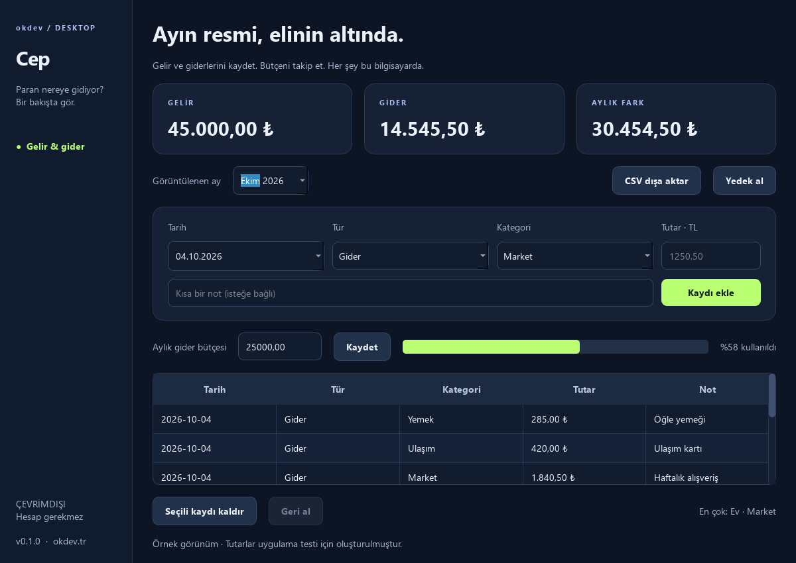

# Cep

**Paran nereye gidiyor? Bir bakışta gör.** Türkçe, çevrimdışı kişisel gelir-gider uygulaması.

[Windows için indir](https://github.com/okdev01/cep/releases/download/v0.1.0/Cep-0.1.0-Windows-x64.zip) · [Tüm sürümler](https://github.com/okdev01/cep/releases) · [English summary](#english)



## Kullanım

1. ZIP dosyasını indir, tamamını çıkar ve **Cep.exe** dosyasını aç.
2. Tarih, gelir/gider türü, kategori ve tutar girip **Kaydı ekle** düğmesine bas.
3. Üstteki ay seçiciden farklı ayları incele.
4. İstersen aylık gider bütçesi belirle; kullanım oranını takip et.
5. **CSV dışa aktar** ile ayın kayıtlarını al veya **Yedek al** ile tüm veriyi sakla.

Tutarı `1250,50` veya `1250.50` şeklinde, binlik ayırıcı olmadan yaz. Tüm kayıtlar
Türk lirasıdır. Hesaplamalarda tam sayı kuruş kullanılır.

Python, internet veya hesap gerekmez. `_internal` klasörünü EXE'nin yanında tut.

## Neleri içerir?

- Tarih, kategori ve notla gelir/gider kaydı.
- Aylık toplam gelir, gider ve aradaki fark.
- Ay bazında gider bütçesi ve kullanım göstergesi.
- En çok harcama yapılan kategorilerin özeti.
- Kayıt kaldırma ve o oturumdaki son kaldırmayı geri alma.
- Excel uyumlu UTF-8 CSV dışa aktarma; not alanında formül çalışmasını önleyen kaçış.
- SQLite veritabanı yedeği.

## Veriler ve kapsam

Veriler `%LOCALAPPDATA%\OkdevDesktop\Cep\cep.db` dosyasında tutulur. Bankaya
bağlanmaz, internet üzerinden veri göndermez. Veritabanı ve yedekler şifrelenmez;
bilgisayarında dosyaya erişebilen kişiler kayıtları okuyabilir.

Bu sürüm manuel kişisel kayıt içindir. Banka entegrasyonu, çoklu para birimi,
otomatik tekrar eden işlemler, muhasebe/fatura işlevi ve CSV içe aktarma içermez.
Aylık fark yalnızca kaydedilen o ayki gelir ve gider farkıdır; banka bakiyesi değildir.
Bir kaydı düzeltmek için kaldırıp yeniden ekleyebilirsin.

Yedeği geri yüklemek için Cep'i kapat, mevcut `cep.db` dosyasını farklı bir adla
sakla ve yedeğin bir kopyasını aynı klasöre `cep.db` adıyla yerleştir. Uygulama
içinden yedek geri yükleme henüz yoktur. Windows x64 paketi kod imzalı değildir.

## Geliştirme

```powershell
python -m venv .venv
.\.venv\Scripts\python -m pip install -r requirements-build.txt
.\.venv\Scripts\python main.py
.\.venv\Scripts\python -m unittest -v
.\.venv\Scripts\python main.py --smoke-test smoke-result.json --preview preview.png
.\.venv\Scripts\python build.py
```

Python 3.14. Sekiz test; ondalık doğrulama, ay/yıl sınırları, kuruş hassasiyeti,
geri alma, bütçe kalıcılığı, CSV ve yedekleme işlevlerini kapsar. Arayüz/EXE
kontrolleri geçici örnek veriler kullanır. Ekran görüntüsündeki tutarlar kurgusaldır.

## English

An offline personal income/expense tracker for Windows with a Turkish Qt interface,
integer-cent accounting, monthly budgets, reversible removal, CSV exports and
local SQLite backups. No bank connection or account required.

MIT · [Orçun Kara / okdev](https://okdev.tr). [Dependency notices](THIRD_PARTY_NOTICES.txt).
